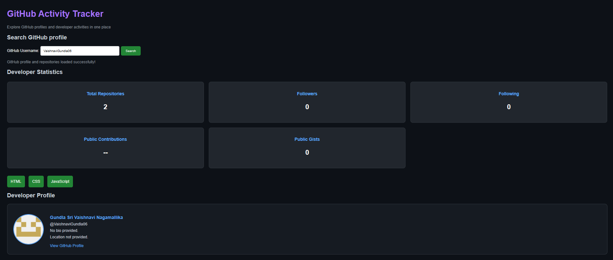
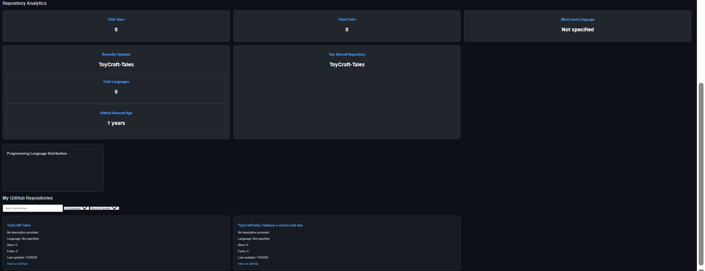

# GitHub Activity Tracker

A responsive web dashboard that allows users to explore GitHub profiles, repositories, and repository statistics using the GitHub REST API.

## Overview

GitHub Activity Tracker provides a simple way to explore a developer's public GitHub profile and repository information in one place.

Users can search for a GitHub username and view profile details, repository information, and programming language analytics.

## Features

- **GitHub Profile Search:** Fetch public GitHub profile information using a username.
- **Profile Statistics:** Display public repositories, followers, following, and public gists.
- **Repository Explorer:** View repository descriptions, programming languages, stars, forks, and last updated dates.
- **Search and Filter:** Search repositories by name and filter them by programming language.
- **Sorting:** Sort repositories based on available sorting options.
- **Load More:** Display repositories in manageable groups.
- **Analytics Dashboard:** View total stars, total forks, most-used language, and language distribution.
- **Responsive Design:** Adapt the dashboard to different screen sizes.
- **Error Handling:** Handle invalid usernames, network failures, and API request errors.

## Screenshots





## Technologies Used

- HTML5
- CSS3
- JavaScript
- GitHub REST API
- Chart.js

## Project Structure

```text
GitHub-Activity-Tracker/
│
├── index.html
├── README.md
├── script.js
├── style.css
│
└── screenshots/
    ├── dashboard.png
    └── repositories.png
```

## How to Run the Project

1. Clone or download this repository.
2. Open the project folder in Visual Studio Code.
3. Run the project using a local development server.
4. Open the application in your browser.
5. Enter a GitHub username and click Search.

## API Used

GitHub REST API:

`https://api.github.com/users/{username}`

The application uses GitHub's public REST API to retrieve profile details and repository information.

**Note:** The dashboard displays repository-based statistics and language distribution. It does not currently calculate GitHub contribution counts.

## Future Improvements

- Add authenticated GitHub API access.
- Explore contribution activity using an appropriate data source.
- Add more repository analytics.
- Improve dashboard customization.

## Author

**Vaishnavi Gundla**

GitHub: [VaishnaviGundla06](https://github.com/VaishnaviGundla06)

LinkedIn: [Vaishnavi Gundla](https://linkedin.com/in/vaishnavi-gundla-3bb369352/)

---

*Built as a hands-on project to practice frontend development, REST API integration, and data visualization.*
